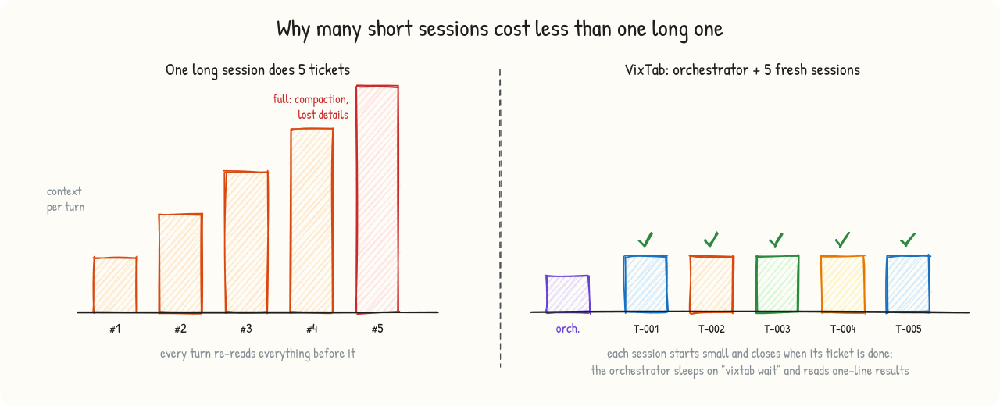
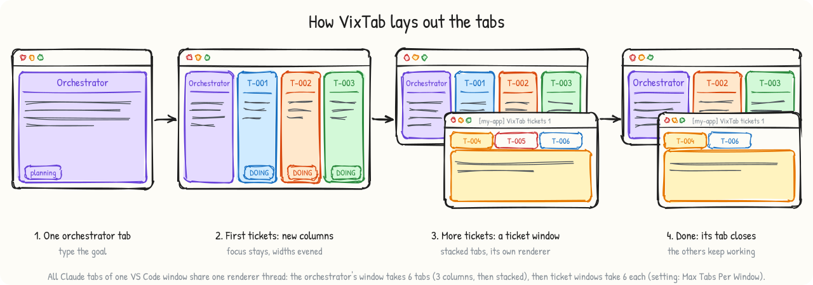
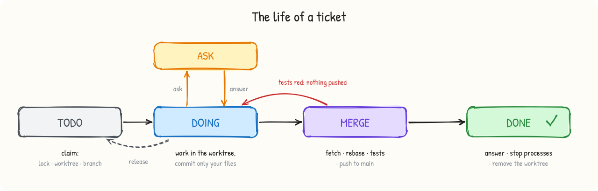
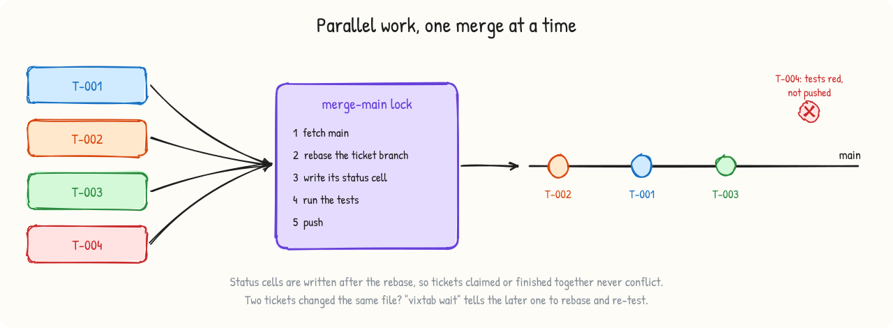
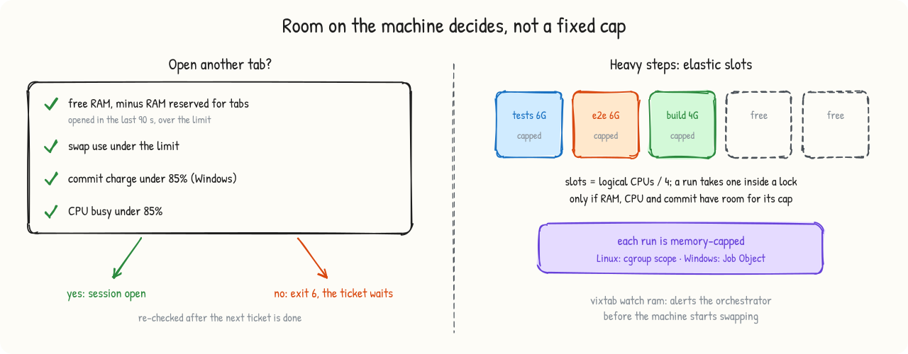
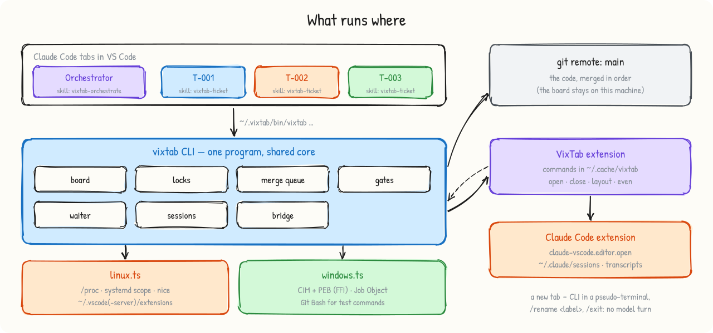

<p align="center"></p>

<h1 align="center">VixTab</h1>

<p align="center"><b>Run many Claude Code sessions in parallel on one repository — one fresh, labeled VS Code tab per ticket,<br>
conflict-free merges, and an orchestrator that keeps its own context small.</b></p>

<p align="center">
<a href="https://github.com/VixAgent/vixtab/actions/workflows/ci.yml"></a>
<a href="https://github.com/VixAgent/vixtab/releases"></a>
<a href="LICENSE"></a>

</p>

<p align="center">English · <a href="README.vi.md">Tiếng Việt</a></p>

<picture><source media="(prefers-color-scheme: dark)" srcset="docs/images/hero-dark.svg"></picture>

## Why VixTab

A single long Claude Code session gets slower and more expensive as it goes: every turn re-reads a context that keeps growing,
until it is compacted and details are lost. Splitting the work across several sessions by hand is tedious and risky: two
sessions edit the same files, push over each other, forget dev servers, and you spend your time copying prompts between tabs.

VixTab turns one Claude Code tab into an **orchestrator**. It splits your goal into self-contained tickets, opens a **fresh tab
for each ticket** in its own column, gives it a one-line assignment, sleeps until something happens, and closes the tab when
the ticket is done. Every ticket works in its own git worktree and lands on `main` through a test-gated merge queue.

## Features

- **Context-saving orchestration.** The orchestrator never implements tickets. Each ticket gets a new session that starts
  small and ends when the ticket is done; the orchestrator reads one-line results and waits on a background process, so it
  spends no tokens while nothing happens. [How it works ↓](#how-the-orchestration-saves-context)
- **A tab per ticket, and a renderer per window.** Each tab is labeled with the ticket id and opens without stealing focus:
  in the orchestrator's own window first (up to 6 Claude tabs: 3 columns, then stacked), then stacked in **ticket windows** — separate VS Code
  windows, five Claude tabs each — because all tabs of one window share one renderer thread. Creating a tab runs no model turn:
  it costs no tokens and the tab uses your default model. A simple ticket can run on a cheaper model instead
  (`ticket new … --model sonnet`): one short turn sets it for that tab only. [Why ↓](#one-renderer-per-window)
- **Parallel without conflicts.** Atomic locks, one git worktree and branch per ticket, and a serialized merge queue that
  rebases, runs the tests after the rebase and only then pushes. Red tests never land.
- **A private board.** Tickets, questions and answers live in a git repository on your machine, next to the project and
  never pushed: your remote receives only code. [Where ↓](#where-the-board-lives)
- **Sessions wait for each other, only when they must.** Parallel is the default. A ticket created `--after T-003` cannot be
  claimed before T-003 is done, and the orchestrator is woken with `ready T-005` the moment it can start; a session that asks a
  question waits for the answer; two tickets on the same file both run, and the later one is told to rebase when the first
  lands; tickets beyond the machine's room wait in the queue. [How ↓](#sessions-wait-for-each-other-only-when-they-must)
- **Resource gates instead of a fixed session cap.** A new tab opens only when free RAM (minus RAM reserved for tabs opened in
  the last 90 s), swap, commit charge (Windows) and CPU have room. Heavy steps (full test suites, E2E, builds, browsers) go
  through elastic, memory-capped slots — a cgroup scope on Linux, a Job Object on Windows.
- **Questions without ping-pong.** A blocked session asks with `vixtab ticket ask`; the question lands in the ticket on
  the board, the orchestrator is woken up, answers once, and the session continues.
- **Clean-up you can trust.** `done` refuses to push untested code, stops processes left in the worktree (dev servers,
  browsers), and removes the worktree. Test commands always run with `pipefail`, so `… | tail` cannot hide a red test. Orphans are found later with `vixtab procs orphans`. VS Code, Claude Code, sshd and the
  desktop shell are never stopped.
- **Linux and Windows.** One code base; everything OS-specific lives in two small adapters. Ships as a single program with
  the runtime included — no Bun, Node or Python needed.
- **A playground** to try all of this safely, with or without spending tokens.

## Quick start

<picture><source media="(prefers-color-scheme: dark)" srcset="docs/images/install-dark.svg"></picture>

1. **Install the extension.** In VS Code: Extensions ▸ search **VixTab** (`vixagent.vixtab`). Or download the
   `.vsix` for your platform from [Releases](https://github.com/VixAgent/vixtab/releases) and run
   `code --install-extension vixtab-linux-x64.vsix` (or `vixtab-win32-x64.vsix`). The Claude Code extension is installed
   with it if you do not have it yet. Up to 0.6.0 the extension was `phanthaitrung.vixtab`; the new one removes it and asks
   you to reload each window that still runs it.
2. **Choose where VixTab applies** in the setup notification: **every project** (the default) or **only the projects you
   choose**. Setup copies the `vixtab` program to `~/.vixtab/bin`, puts it on your PATH and installs the two Claude Code skills
   `vixtab-orchestrate` and `vixtab-ticket` accordingly.
3. **Open a repository and click "VixTab"** in the status bar. An *Orchestrator* tab opens with `/vixtab-orchestrate` already
   typed in. Add your goal — for example *"fix issues #12, #15 and #18 in parallel"* — and press Enter.

**Every project, or only the ones you choose.** The skills scope is saved and kept across upgrades:

| Scope | Where the skills live | Who can use VixTab |
|---|---|---|
| **every project** (default) | `~/.claude/skills` | any Claude Code session on this machine: click VixTab in any repository, or ask Claude to use VixTab |
| **only chosen projects** | `<repo>/.claude/skills`, kept out of git (`--commit` to share with your team) | the repositories where you clicked VixTab or ran `vixtab init` / `vixtab skills install`; other projects never see it |

**The VixTab panel.** The VixTab icon in VS Code's Activity Bar (the left bar, next to Claude Code's) opens a panel with *Start
orchestrator*, whether this project can use VixTab (one-click set-up if not), the board's tickets with their status (click one
to read it), versions, the playground, the doctor and the settings.

Its **Tabs** section shows every Claude tab running on this machine, in every project, grouped by VS Code window: a summary
(`9 tabs · 3 busy · 5 idle · 1 asking · 5 windows · RAM 92GB free · CPU 4 %`, measured by the resource gate, with whether a new
tab can open), each window with its number of Claude tabs and its renderer load (⚠ from 90 %: that window's tabs lag), each tab
with its state (busy, idle, asking) and for how long, its ticket's status and the model VixTab opened it on (click a ticket tab
to read the ticket), then *Finished and closed*: the tabs VixTab opened that have closed since, newest first (last 50; *Clear*
empties it). It refreshes every 5 s while the panel is visible, renderer load at most once a minute. Windows without the
VixTab extension are not listed. The same in a terminal: `vixtab tabs` (`--load` for renderer load).

**Is VixTab set up in a project, and which version?** Look at the panel, or run `vixtab status` inside the project (also
*VixTab: Show status*):

```
VixTab in /home/me/my-app: YES, its Claude Code sessions can use VixTab
  CLI        v0.5.0 (~/.vixtab/bin/vixtab)
  extension  vixagent.vixtab v0.5.0 installed
             window 4242: v0.4.1 (this window)  /home/me/my-app  ← older than 0.5.0 — reopen that window to load the new one
  skills     scope every project; this project uses the copies for every project v0.5.0
  board      /home/me/my-app.vixtab/board (private): 7 ticket(s), 2 not done
```

Every installed skill file carries the version that wrote it (`<!-- vixtab-managed v0.5.0: … -->`); a VS Code window keeps the
extension version it started with until it is reopened. `vixtab status --json` gives the same for scripts.

Change the scope in *Settings ▸ VixTab: Skills Scope*, or with `vixtab skills scope global|project` (`vixtab setup --scope …`,
`VIXTAB_SKILLS_SCOPE` for the one-line installers). `vixtab skills status` shows where the skills are. Either way the
orchestrator skill does not start on its own from a general word like "orchestrator": Claude asks whether you mean VixTab.

The first time, the orchestrator offers to create the ticket board (`vixtab init`): a private board next to the repository,
with nothing committed in the project. There is no folder-trust prompt to click through: the repository is open in VS Code,
which already trusts it (see *Security*).

**Requirements:** VS Code 1.90+, the Claude Code extension (signed in), git, and a remote with a `main` branch (merges are
rebased on it and pushed there; a local bare repository is fine). Linux x64/arm64 or Windows 10/11 x64.

Terminal only? `curl -fsSL https://raw.githubusercontent.com/VixAgent/vixtab/main/install.sh | bash` (Linux) or
`irm https://raw.githubusercontent.com/VixAgent/vixtab/main/install.ps1 | iex` (Windows PowerShell), then `vixtab doctor`.

## Try it in the playground

`vixtab playground create` (or *VixTab: Create playground*) builds a sandbox in `~/vixtab-playground`: a local bare "origin",
a tiny recipe-book project and five tickets designed to show everything — three independent tickets, one that shares a file
with another, and one that must ask a question. Nothing in it can reach GitHub or your real projects.

| Level | What you see | Needs | Tokens |
|---|---|---|---|
| `vixtab playground demo board` | 4 parallel claims, an early claim (before its After ticket) refused, duplicate claim refused, overlap report, merge queue, red tests blocked, `rebase`, `ready` and `ask` events, `done` stopping a leftover process, an abandoned lock taken over, no board file on the project's remote — 20 checks | a terminal | none |
| `vixtab playground demo tabs` | three labeled Claude tabs opening in new columns to the right, evened, then closed | VS Code + VixTab | none |
| `vixtab playground demo heavy` | five heavy runs sharing two slots; a run over its memory cap is stopped | a terminal | none |
| Open `~/vixtab-playground/project`, click **VixTab**, type *do all tickets on the board* | the real thing: an orchestrator opens a tab per ticket, they work, merge, ask, finish, and their tabs close | Claude Code signed in | a little |

The scripted board demo takes about 10 s on Linux and 80 s on Windows, and doubles as the end-to-end test in CI.

## How the orchestration saves context

<picture><source media="(prefers-color-scheme: dark)" srcset="docs/images/context-saving-dark.svg"></picture>

1. **The orchestrator plans, dispatches and verifies — it does not implement.** Each ticket runs in a fresh session, so no
   context ever holds more than one ticket.
2. **Tickets are self-contained:** what to change, where (files, functions, line hints), why, the expected result, and the exact
   verification command. The working session does not explore the repository.
3. **One-line assignments.** *"Work on ticket T-003 with the vixtab-ticket skill."* The rules live in the skill, read once.
4. **Waiting costs nothing.** `vixtab wait T-001:<pid> …` runs in the background and exits only when a ticket is done, asks a
   question, needs a rebase, or its session died. No polling loop in the conversation.
5. **Opening a tab costs nothing.** VixTab starts the Claude CLI in a pseudo-terminal, types `/rename <label>` and `/exit` —
   no model turn — then asks the VS Code extension to open that session in a new column.
6. **Cheap checks.** Before closing a tab, the orchestrator trusts `vixtab ticket list` and the waiter instead of reading
   transcripts or diffs.
7. **Handover.** When the orchestrator's own context gets large, it writes a short handover note, opens a fresh
   *Orchestrator-2* tab and stops.

<picture><source media="(prefers-color-scheme: dark)" srcset="docs/images/layout-flow-dark.svg"></picture>

## Sessions wait for each other, only when they must

<picture><source media="(prefers-color-scheme: dark)" srcset="docs/images/dependencies-dark.svg"></picture>

Tickets run in parallel by default. A session waits only for one of these reasons, and spends no tokens while it waits:

| Reason | How it is declared | What enforces it | What wakes things up |
|---|---|---|---|
| it needs another ticket's result | `vixtab ticket new … --after T-003[,T-004]` (the **After** column) | `claim` refuses (exit 8) until every After ticket is ✅ DONE; `vixtab ticket ready` lists what can start | the orchestrator's waiter prints `ready T-005` together with `done T-003` |
| it has a question | `vixtab ticket ask T-002 "…"` (status ❓ ASK, question in the ticket) | the session stops | `ask T-002 #1` → the orchestrator answers (`ticket answer`), or asks you first |
| it shares a file with another ticket | the ticket's **Area**; `vixtab ticket overlap` | merges are serialized; tests run after the rebase | `rebase T-004 recipes/INDEX.md` when the other ticket lands |
| the machine is full | — | `session open` exits 6 while the resource gate is closed | the next `done` frees room; the ticket opens then |
| its session died | — | the ticket keeps its lock and worktree | `gone T-002` → a fresh session continues with `--takeover` |

A ticket session can also wait by itself: `vixtab wait --as T-005 T-003` in the background, then rebase and continue when it
prints `done T-003`. Several orchestrators can wait side by side: each `--as` name keeps its own record of the events it has seen.

## One renderer per window

Every Claude Code tab of a VS Code window runs in that window's **single renderer thread**. On a 44-thread Windows workstation,
14 visible columns drove that thread to 102 % of one core and froze every session, while total CPU was at 64 % and 60 GB of RAM
were free. Hidden tabs keep running too: 7 stacked tabs still reached 91 %.

So VixTab spreads tabs over windows (`"tabs"` in `vixtab.config.json`):

| Mode | Where a new ticket tab goes |
|---|---|
| `auto` (default) | **the orchestrator's own window first**, until it holds `inWindowMax` (6) Claude tabs, the orchestrator included: new columns up to `columnsMax` (3), then stacked in the last column. Then the **ticket window** with the fewest Claude tabs below `perWindowMax` (5), stacked in one group; only when all are full does VixTab open a new ticket window |
| `windows` | always ticket windows; the orchestrator's window keeps only the orchestrator |
| `columns` | always new columns in the orchestrator's window (fine for a few tickets) |

A ticket window is a VS Code window titled `[<project>] VixTab tickets N`, opened from
`<repo>/.vixtab/windows/<project>-tickets-N.code-workspace` (kept out of git through
`.git/info/exclude`). The file lives inside your repository on purpose: VS Code opens a workspace file from an untrusted
location in Restricted Mode, where Claude Code does not run. When the last Claude tab of a ticket window closes, the window closes
too (setting `vixtab.closeEmptyTicketWindows`). `vixtab session close` finds a tab in any window;
`vixtab session count` lists every window with its Claude tabs and, for local VS Code, the busiest renderer thread
(≈ 90 % or more ⇒ that window's tabs lag).

## The ticket lifecycle

<picture><source media="(prefers-color-scheme: dark)" srcset="docs/images/lifecycle-dark.svg"></picture>

The board's `README.md` is a table with one row per ticket (`☐ TODO`, `⏳ DOING (session)`, `❓ ASK (session)`,
`✅ DONE (session)`), next to one Markdown file per ticket. Every change (new ticket, claim, question, answer, release, done) is
one commit on the board, so its history shows who did what and when. A session writes its `## Answer` in the ticket file that
`claim` printed; `done` commits it with ✅ DONE once the code is on `main`.

## Where the board lives

The board is private to your machine: `<home>/board`, where `<home>` is `<parent>/<repo>.vixtab` next to the repository (the
folder that also holds the ticket worktrees and locks; `VIXTAB_HOME` moves it). It is a git repository with its own history,
without a remote: it is not part of the project and is never pushed, so a public repository shows only your code. VixTab's
settings sit next to it in `<home>/vixtab.config.json`. `vixtab board path` prints the folder; to back the board up, copy it.
The orchestrator keeps its handover note there too (`vixtab board write HANDOVER.md --file …`).

**Boards made by VixTab 0.7.0 and older** are a `tickets/` folder and a `vixtab.config.json` on your main branch, published
with your code. They keep working, with a warning, until you move them:

```bash
vixtab board migrate --dry-run   # what would move, and where
vixtab board migrate             # copy the board into <home>/board, then one commit on main removes tickets/ and the config
```

The migration is refused while a ticket is ⏳ DOING or ❓ ASK (`--force` overrides), and `--keep-on-main` leaves the old copy on
`main`. Running it again changes nothing. The removed files stay in your remote's git history: whether to rewrite that history
is your decision, and VixTab never does it.

## Parallel without conflicts

<picture><source media="(prefers-color-scheme: dark)" srcset="docs/images/merge-queue-dark.svg"></picture>

- **Claim** creates the lock `T-NNN` with `mkdir` (atomic on ext4 and NTFS): two sessions can never take the same ticket.
- Each ticket gets a worktree `<repo>.vixtab/wt-T-NNN` on branch `vixtab/T-NNN`, and a private port in `.vixtab.env`
  (`base + ticket number`, moved by +1000 when something already listens there).
- **Every write to `main` goes through one lock**, `merge-main`: fetch, rebase, tests, push. ✅ DONE is written on the board
  after the push, still under that lock, so the board never says done before the code is on `main`.
- **Board edits take their own lock**, `board`, and each one commits only the files it changed, so tickets claimed or
  finished at the same moment never conflict on neighbouring rows.
- **Tests run after the rebase**, on exactly what will be pushed. Red ⇒ nothing is pushed.
- Locks whose owner died (same host, pid gone) are taken over automatically, through a second lock so that two sessions cannot
  both "repair" the same lock.

## Resource gates

<picture><source media="(prefers-color-scheme: dark)" srcset="docs/images/gates-dark.svg"></picture>

Defaults scale with the machine: minimum free RAM = total/8 (4–16 GB), maximum swap = total/4 (4–16 GB), commit and CPU 85 %,
1 GB reserved per tab opened in the last 90 s. Heavy slots = max(2, logical CPUs / 4), each run capped at 6 GB unless
`--mem` says otherwise; a run starts only if free RAM minus the caps of runs that started in the last 90 s leaves its own
cap + 4 GB. `vixtab session count` shows the gate; `vixtab watch ram` alerts the orchestrator before the machine swaps.

## Commands

| Command | What it does |
|---|---|
| `vixtab setup` · `vixtab doctor [--brief]` | install CLI + skills · check everything, with the fix for each problem |
| `vixtab init` | create the private board and `vixtab.config.json` in `<home>`; nothing is committed in the project |
| `vixtab board path` · `write <name> --file F` · `migrate [--dry-run] [--keep-on-main] [--force]` | the board's folder · add or replace an extra file (HANDOVER.md) · move a board made by 0.7.0 or older off `main` |
| `vixtab ticket list` · `new "<title>" [--area …] [--after T-x] [--model <m>] [--body-file F]` · `show <id> [--questions]` | the board; `--model` writes the ticket's **Model** line |
| `vixtab ticket ready [--json]` | tickets that can start now, and what the others wait for |
| `vixtab ticket claim <id> --as <session> [--takeover] [--ignore-after]` | lock + worktree + branch + ⏳ DOING (refused, exit 8, while an After ticket is not done) |
| `vixtab ticket merge <id> [-- <test command>]` | rebase, test after rebase, push |
| `vixtab ticket done <id>` · `release <id>` | ✅ DONE + clean-up · give the ticket back |
| `vixtab ticket ask <id> "<question>"` · `answer <id> "<answer>"` | ❓ ASK ↔ ⏳ DOING, recorded in the ticket |
| `vixtab ticket overlap [<id>…]` | files changed by two or more active tickets |
| `vixtab session open <label> [--model <m>]` · `close <label> [<pid>]` · `count` · `list` | labeled Claude tabs, resource-gated; `--model` (or the ticket's Model line) picks the model for that tab only |
| `vixtab tabs [--json] [--load]` · `tabs clear` | every Claude tab of this machine by VS Code window: state and for how long, ticket status, model, renderer load (`--load`); the tabs VixTab opened that have closed |
| `vixtab tab layout` · `even` · `join` · `open <session>` · `close <label>` · `windows` · `new-window` | low-level tab control, ticket windows |
| `vixtab wait [--as <name>] <id>[:<pid>] …` | sleep until `done` / `ready` / `ask` / `rebase` / `gone` events (any session can use it) |
| `vixtab heavy [--mem 6G] -- <command>` | run a heavy step through elastic, capped slots |
| `vixtab watch ram` · `vixtab procs list\|kill <dir>` · `procs orphans [--kill]` · `vixtab lock <name> -- <cmd>` | machine helpers |
| `vixtab playground create\|demo board\|demo tabs\|demo heavy\|check\|reset\|remove` | the sandbox |

`vixtab help <command>` prints the details and exit codes.

## Configuration

`<home>/vixtab.config.json`, written by `vixtab init` (all fields optional). A `vixtab.config.json` at the repository root
wins, for a team that commits one on purpose; only that one can set `"home"`, otherwise use `VIXTAB_HOME`.

```json
{
  "branch": "main",
  "remote": "origin",
  "ticketPrefix": "T-",
  "ticketDigits": 3,
  "test": "bun test",
  "setup": "bun install",
  "ports": { "base": 4000 },
  "env": { "VITE_PORT": "{port}" },
  "hotFiles": ["src/types.ts"],
  "tabs": { "mode": "auto", "inWindowMax": 6, "columnsMax": 3, "perWindowMax": 5 },
  "sessions": { "max": 0, "minFreeRamMB": 8192, "maxSwapMB": 8192, "maxCpu": 0.85, "reserveMB": 1024 },
  "heavy": { "slots": 4, "mem": "6G", "headroomMB": 4096 }
}
```

Environment overrides: `VIXTAB_HOME`, `VIXTAB_REPO`, `VIXTAB_MAX_SESSIONS`, `VIXTAB_MIN_FREE_RAM_MB`, `VIXTAB_MAX_SWAP_MB`,
`VIXTAB_MAX_CPU`, `VIXTAB_MAX_COMMIT`, `VIXTAB_HEAVY_SLOTS`, `VIXTAB_HEAVY_MEM`, `VIXTAB_TAB_MODE`, `VIXTAB_TABS_IN_WINDOW`,
`VIXTAB_TABS_PER_WINDOW`, `VIXTAB_CLAUDE_BIN`, `VIXTAB_EXT_HOST_PID` (pin every tab action to one window),
`VIXTAB_ORCHESTRATOR_WINDOW` (the orchestrator's window when you drive VixTab from outside VS Code; the tabs policy still applies).

## How it works

<picture><source media="(prefers-color-scheme: dark)" srcset="docs/images/architecture-dark.svg"></picture>

- **Extension bridge.** The VixTab extension registers its window in `~/.cache/vixtab/windows/<pid>.json` and executes tab
  commands written to `~/.cache/vixtab/commands/<pid>-<id>.cmd.json` — only the window whose extension-host pid is in the file
  name acts, so tabs open in the window you are working in. Tab actions run one at a time.
- **Labeled sessions without tokens.** `vixtab session open` runs the Claude CLI that ships with the Claude Code extension in a
  pseudo-terminal, types `/rename <label>` and `/exit`, then the extension opens that session with Claude Code's
  `claude-vscode.editor.open` command; the tab takes its label from the session title.
- **Model per ticket.** On resume Claude Code restores the model of the session's last answer. With `--model <m>` (or a
  `- **Model:** <m>` line in the ticket) the bootstrap CLI runs with `--model <m>` and the model answers one short prompt, so
  the tab continues on that model. That one turn is the only cost; no settings file is written and the user's default stays.
- **Sessions and transcripts** are found in `~/.claude/sessions` and `~/.claude/projects`.
- **Skills** (`~/.claude/skills/vixtab-*/SKILL.md` for every project, or `<repo>/.claude/skills/…` per repository) hold the
  protocol for the orchestrator and for ticket sessions, so the assignment message stays one line. Ticket sessions start in the
  repository root and see project skills too; linked worktrees without their own `.claude/skills` use the main checkout's
  (Claude Code 2.1.277+). Prefer plugins?
  `/plugin marketplace add VixAgent/vixtab` then `/plugin install vixtab@vixtab` installs the same skills (the extension is still
  needed for tabs; a plugin is enabled for all projects unless you scope it).

| | Linux | Windows |
|---|---|---|
| processes + working directories | `/proc` (your own processes) | CIM + the PEB read through FFI |
| stopping processes | SIGTERM, 5 s, SIGKILL | TerminateProcess |
| memory cap of heavy runs | `systemd-run --user --scope MemoryMax` (none without a systemd user session, e.g. WSL) | Job Object memory limit |
| free RAM · swap · commit | `/proc/meminfo` | `GlobalMemoryStatusEx` · page file · commit limit |
| test commands | `bash -o pipefail -c` (dash has no pipefail) | Git Bash with pipefail (never the WSL `bash.exe`), else `cmd.exe` |
| busiest renderer thread | `/proc/<pid>/task` of local `code --type=renderer` (not visible with VS Code Remote) | thread times of `Code.exe --type=renderer` |
| leftovers after `git worktree remove` | — | junctions (bun's `node_modules`) unlinked without following them, empty folders removed, real files kept |
| path comparison | case-sensitive | case-insensitive, `d:` = `D:`; reserved names (`CON`, `NUL`…) refused in ticket slugs |

## Limitations

- VixTab relies on parts of Claude Code that are **not public APIs**: the `claude-vscode.editor.open` command, the session
  registry, the transcript format and `/rename`. They were checked with Claude Code 2.1.280 (Linux, VS Code Remote SSH) and
  2.1.308 to 2.1.310 (Windows); a Claude Code update can break them. `vixtab doctor` checks what it can.
- Claude Code opens only sessions of the window's own folder: run the orchestrator in a window whose folder is the repository
  (ticket windows open the repository too).
- Opening a ticket window needs the `code` command and a VS Code that can open windows (not a locked screen); if it cannot, the
  tab opens as a column in the orchestrator's window and `session open` prints a warning.
- Closing a Claude tab can take up to a minute while Claude Code shuts the session down. With Claude Code 2.1.280, two tabs
  closed at the same moment can leave Claude Code unable to open tabs ("Webview is disposed") until the window is reloaded;
  VixTab therefore runs tab actions one at a time. See [troubleshooting](docs/troubleshooting.md).
- Older Claude Code versions address sessions by an auto-generated name instead of the tab label; `session open` prints both.
- Locks and the board are per machine. Several machines can share a remote, but each machine orchestrates its own sessions
  on its own board.
- macOS is not supported yet (most of the code is POSIX; contributions welcome).
- VixTab is an independent project, not affiliated with or endorsed by Anthropic.

## Security

- The extension only accepts four actions on Claude tabs (open, close, layout, even), validates session ids and labels, and
  runs nothing else. Any process of your user account can write a command file — the same trust boundary as your account.
- `vixtab` talks to the network only through git. It never stops protected processes (VS Code, Claude Code, sshd, the
  desktop shell).
- **What reaches your remote.** With a private board, only the code that ticket sessions merge. The board (tickets, questions, answers, who worked
  on what) and VixTab's config stay on your machine; `vixtab board migrate` is the one command that commits to `main` on its
  own, to remove an old board from it.
- **Folder trust.** To create a labeled session without a model turn, VixTab briefly runs the Claude CLI (it types
  `/rename` and `/exit`). It does so only for a folder that is open in a VS Code window running VixTab — VS Code runs extensions
  only in workspaces it trusts, and the Claude Code tab there runs without its own trust prompt — and passes that CLI Claude Code's
  `CLAUDE_CODE_SANDBOXED` switch so it does not stop at *Do you trust the files in this folder?*. Nothing is written to
  `~/.claude.json`: a `claude` you start yourself in a terminal still asks. For any other folder VixTab stops and answers the
  prompt only with `--trust`.
- Report vulnerabilities as described in [SECURITY.md](SECURITY.md).

## Development

```bash
bun install
bun run vixtab doctor          # run from source
bun test test/                 # unit tests + the playground demo
bun run typecheck
bun run diagrams               # re-draw docs/images (rough.js + Patrick Hand, OFL)
bun run build                  # dist/: CLIs, .vsix per platform, archives, SHA256SUMS
```

See [CONTRIBUTING.md](CONTRIBUTING.md).

## License

[MIT](LICENSE) © phanthaitrung. The diagrams use the Patrick Hand font (SIL Open Font License 1.1).
