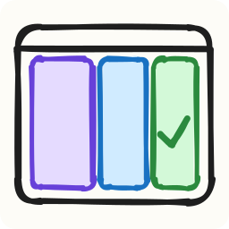
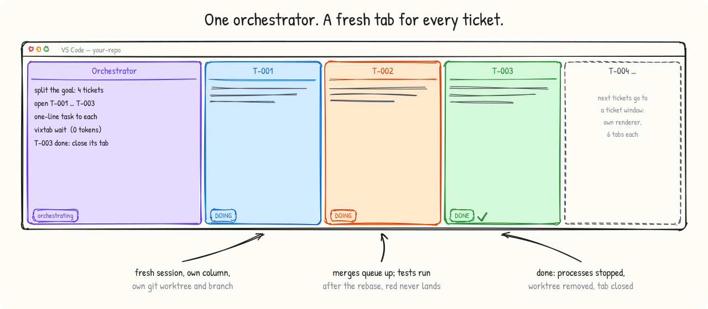
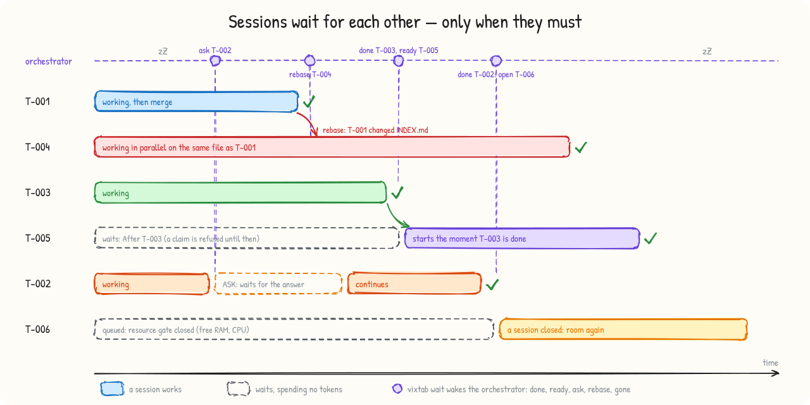
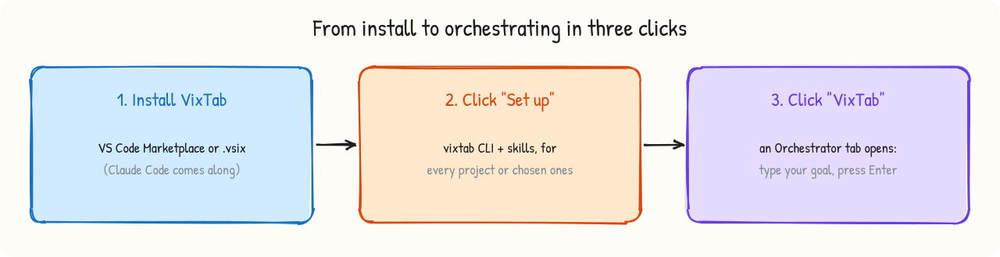

<p align="center"></p>

<h1 align="center">VixTab</h1>

<p align="center"><b>Chạy nhiều phiên Claude Code song song trên cùng một repo: mỗi phiếu một tab VS Code mới có nhãn riêng,
gộp mã không xung đột, phiên điều phối giữ ngữ cảnh của chính nó luôn nhỏ.</b></p>

<p align="center"><a href="README.md">English</a> · Tiếng Việt</p>

<picture><source media="(prefers-color-scheme: dark)" srcset="docs/images/hero-dark.svg"></picture>

## VixTab giải quyết việc gì

Một phiên Claude Code làm việc lâu sẽ chậm dần và tốn dần: mỗi lượt phải đọc lại toàn bộ ngữ cảnh ngày càng dài, tới lúc bị nén
thì mất chi tiết. Tự tay chia việc cho nhiều phiên thì mất công và dễ hỏng: hai phiên sửa cùng một tệp, đẩy đè lên nhau, bỏ quên
máy chủ dev, còn người dùng phải chép lời nhắn qua lại giữa các tab.

VixTab biến một tab Claude Code thành **phiên điều phối**. Phiên này chia mục tiêu thành các phiếu tự đủ, **mở cho mỗi phiếu một
tab mới** ở cột riêng, giao việc bằng một dòng, nằm chờ tới khi có sự kiện, rồi đóng tab khi phiếu xong. Mỗi phiếu làm trong
worktree git riêng và vào nhánh `main` qua hàng đợi gộp có chạy test.

## Chức năng

- **Điều phối tự động, tiết kiệm ngữ cảnh.** Phiên điều phối không tự làm phiếu. Mỗi phiếu chạy trên một phiên mới, ngữ cảnh nhỏ,
  xong thì đóng. Phiên điều phối chỉ đọc kết quả một dòng và chờ bằng tiến trình nền, nên không tốn token khi không có việc.
- **Mỗi phiếu một tab, mỗi cửa sổ một renderer.** Nhãn tab là mã phiếu, tab mở không giật focus. Cửa sổ của phiên điều phối
  được dùng trước, tới 6 tab Claude (3 cột, sau đó xếp chồng vào cột cuối). Chỉ khi đầy mới xếp chồng sang **cửa sổ phiếu** (cửa
  sổ VS Code riêng, tối đa 6 tab Claude; chỉ mở cửa sổ mới khi các cửa sổ phiếu đang có đều đầy). Con số 6 đổi được trong
  *Settings ▸ VixTab: Max Tabs Per Window*. Mỗi lần mở tab, VixTab đếm lại số tab Claude mà từng cửa sổ đang có ngay lúc đó,
  nên tab vừa đóng nhường chỗ ngay và không bao giờ mở thêm vào cửa sổ đã đầy. Lý do là mọi tab của một cửa sổ chạy
  chung một luồng renderer (đo trên máy 44 luồng: 14 cột cùng hiện làm luồng đó 102 % một lõi, mọi phiên đơ). Cửa sổ phiếu tự
  đóng khi hết tab. Mở tab không gọi model nên không tốn token, và không phải bấm cho phép tin cậy thư mục khi thư mục đang mở
  trong VS Code. Phiếu đơn giản có thể chạy trên mô hình rẻ hơn (`vixtab ticket new … --model sonnet`) cho riêng tab đó; mô hình
  mặc định của bạn được giữ nguyên.
- **Song song không xung đột.** Khoá nguyên tử, mỗi phiếu một worktree và một nhánh, hàng đợi gộp tuần tự: rebase, chạy test,
  rồi mới đẩy; trạng thái ✅ DONE chỉ được ghi sau khi mã đã lên `main`. Test đỏ không bao giờ vào `main`.
- **Bảng phiếu riêng trên máy.** Phiếu, câu hỏi và câu trả lời nằm trong một repo git trên máy bạn, cạnh dự án, không bao giờ
  được đẩy lên: remote chỉ nhận mã.
- **Các phiên chờ nhau theo ràng buộc, chỉ khi thật cần.** Mặc định các phiếu chạy song song, và phiên đang chờ không tốn token.
  Phiếu tạo với `--after T-003` không nhận được trước khi T-003 xong (`claim` từ chối, mã 8). `vixtab ticket ready` liệt kê các
  phiếu chạy được ngay. T-003 vừa xong thì phiên điều phối được đánh thức với sự kiện `ready T-005` và mở phiếu đó. Phiên có câu hỏi
  thì chờ câu trả lời. Hai phiếu sửa chung một tệp vẫn chạy song song: khi phiếu đầu đã gộp, phiếu sau được báo rebase rồi chạy
  lại test. Máy hết chỗ thì phiếu xếp hàng, mở khi có phiên đóng. Một phiên phiếu cũng có thể tự chờ phiếu khác
  (`vixtab wait --as T-005 T-003`).

<picture><source media="(prefers-color-scheme: dark)" srcset="docs/images/dependencies-dark.svg"></picture>

- **Cổng tài nguyên thay cho trần số phiên.** Chỉ mở tab mới khi RAM trống (đã trừ phần dành cho các tab vừa mở trong 90 giây),
  swap, bộ nhớ cam kết (Windows) và CPU đều còn chỗ. Lượt nặng (trọn bộ test, E2E, dựng, trình duyệt) đi qua các ô co giãn có
  trần bộ nhớ: cgroup trên Linux, Job Object trên Windows.
- **Hỏi đáp gọn.** Phiên bị vướng hỏi bằng `vixtab ticket ask`; câu hỏi ghi vào phiếu trên bảng phiếu, phiên điều phối được đánh thức
  và trả lời một lần.
- **Dọn dẹp an toàn.** `done` từ chối đẩy mã chưa qua test, dừng tiến trình còn chạy trong worktree, gỡ worktree. Không bao giờ
  dừng VS Code, Claude Code, sshd hay vỏ hệ điều hành.
- **Chạy trên Linux và Windows.** Một mã nguồn chung, phần riêng của từng hệ điều hành nằm trong 2 tệp nhỏ. Phát hành dạng một
  chương trình chứa sẵn runtime: máy người dùng không cần Bun, Node hay Python.

## Cài đặt và bắt đầu

<picture><source media="(prefers-color-scheme: dark)" srcset="docs/images/install-dark.svg"></picture>

1. **Cài extension:** trong VS Code tìm **VixTab** (`vixagent.vixtab`), hoặc tải tệp `.vsix` theo hệ điều hành ở trang
   [Releases](https://github.com/VixAgent/vixtab/releases). Extension Claude Code được cài kèm nếu máy chưa có. Tới bản 0.6.0,
   extension mang mã `phanthaitrung.vixtab`; bản mới tự gỡ bản cũ và nhắc tải lại những cửa sổ còn chạy bản cũ.
2. **Chọn phạm vi** ở thông báo cài đặt: **mọi dự án** (mặc định, phiên Claude Code nào trên máy cũng dùng được VixTab) hoặc
   **chỉ dự án được chọn** (chỉ repo nào bạn bấm VixTab mới có). Bước này chép chương trình `vixtab` vào `~/.vixtab/bin`, thêm
   vào PATH và cài 2 skill Claude Code `vixtab-orchestrate`, `vixtab-ticket` theo phạm vi đã chọn.
3. **Mở repo, bấm "VixTab"** ở thanh trạng thái: tab *Orchestrator* mở ra với `/vixtab-orchestrate` điền sẵn. Gõ mục tiêu rồi
   Enter.

**Bảng VixTab ở thanh bên trái.** Biểu tượng VixTab nằm trên thanh hoạt động (Activity Bar) bên trái VS Code, cạnh biểu tượng
của Claude Code. Bấm vào để mở bảng: nút *Start orchestrator*, dự án hiện tại đã dùng được VixTab chưa (chưa thì bấm một lần để
cài), danh sách phiếu kèm trạng thái (bấm để đọc phiếu), phiên bản, playground, doctor và cài đặt. Mục *Tabs* cho thấy mọi tab
Claude đang chạy trên máy theo từng cửa sổ VS Code (đang làm hay đang chờ và đã bao lâu, trạng thái phiếu, mô hình), cùng các
tab VixTab đã mở và đã đóng; trong terminal là lệnh `vixtab tabs`.

**Một dự án đã có VixTab chưa, bản nào?** Xem trên bảng VixTab, hoặc chạy `vixtab status` trong thư mục dự án (hoặc lệnh
*VixTab: Show status*). Lệnh cho biết các phiên Claude Code của dự án có dùng được VixTab không, và phiên bản của CLI, của
extension (đã cài, và bản mà từng cửa sổ đang chạy), của skill (mỗi tệp skill ghi số phiên bản đã cài nó), cùng bảng phiếu.

Phạm vi được lưu lại, nâng cấp không làm đổi. Đổi trong *Settings ▸ VixTab: Skills Scope* hoặc bằng
`vixtab skills scope global|project`. Ở cả hai phạm vi, skill điều phối không tự chạy chỉ vì gặp một từ chung chung như "điều phối":
Claude sẽ hỏi bạn có muốn dùng VixTab không.

Lần đầu, phiên điều phối đề nghị tạo bảng phiếu (`vixtab init`): bảng phiếu riêng nằm cạnh repo, không commit gì vào dự án.
Không phải bấm cho phép tin cậy thư mục: repo đang mở trong VS Code, và VS Code đã tin cậy nó.

**Cần có:** VS Code 1.90 trở lên, extension Claude Code đã đăng nhập, git, một remote có nhánh `main` (repo trần cục bộ cũng
được). Linux x64/arm64 hoặc Windows 10/11 x64.

## Bảng phiếu nằm ở đâu

Bảng phiếu là repo git `<home>/board`, với `<home>` là thư mục `<repo>.vixtab` nằm cạnh repo (cùng chỗ với các worktree và
khoá; đổi bằng `VIXTAB_HOME`). Repo này có lịch sử riêng, không có remote, không thuộc dự án và không bao giờ được đẩy lên.
Cấu hình nằm cạnh nó, ở `<home>/vixtab.config.json`. `vixtab board path` in ra đường dẫn; muốn sao lưu thì chép thư mục đó.

Bảng phiếu do VixTab 0.7.0 trở về trước tạo nằm ở thư mục `tickets/` và tệp `vixtab.config.json` trên nhánh `main`, tức là
được công bố cùng mã. Bảng cũ vẫn chạy (kèm cảnh báo) cho tới khi bạn chuyển nó:

```bash
vixtab board migrate --dry-run   # xem trước sẽ chuyển gì, tới đâu
vixtab board migrate             # chép bảng vào <home>/board, rồi 1 commit trên main gỡ tickets/ và tệp cấu hình
```

Lệnh từ chối chạy khi còn phiếu ⏳ DOING hoặc ❓ ASK (`--force` để bỏ qua); `--keep-on-main` giữ bản cũ trên `main`; chạy lại
lần thứ 2 không thay đổi gì. Các tệp đã gỡ vẫn còn trong lịch sử git của remote: viết lại lịch sử đó hay không là quyết định của
bạn, VixTab không bao giờ tự làm.

## Thử trên playground

`vixtab playground create` tạo sân thử ở `~/vixtab-playground`: một origin trần cục bộ, một dự án "sổ công thức" nhỏ và 5 phiếu
mẫu. Sân thử không chạm tới GitHub hay repo thật.

| Mức | Thấy gì | Tốn token |
|---|---|---|
| `vixtab playground demo board` | 4 phiếu nhận cùng lúc, nhận trùng bị từ chối, dò chồng chéo, hàng đợi gộp, test đỏ bị chặn, sự kiện `rebase` và `ask`, `done` dừng tiến trình sót, chiếm lại khoá bỏ rơi, remote không có tệp nào của bảng phiếu | không |
| `vixtab playground demo tabs` | 3 tab Claude có nhãn mở ở các cột bên phải, chia đều, rồi đóng | không |
| `vixtab playground demo heavy` | 5 lượt nặng chia nhau 2 ô; lượt vượt trần bộ nhớ bị dừng | không |
| Mở `~/vixtab-playground/project`, bấm **VixTab**, gõ *do all tickets on the board* | điều phối thật: mỗi phiếu một tab, làm, gộp, hỏi, xong, tab tự đóng | ít |

## Tài liệu chi tiết

Bảng lệnh, cấu hình `vixtab.config.json`, cách hoạt động, khác biệt Linux và Windows, giới hạn và bảo mật: xem
[README tiếng Anh](README.md) và [xử lý sự cố](docs/troubleshooting.md).

## Giấy phép

[MIT](LICENSE) © phanthaitrung. VixTab là dự án độc lập, không liên kết với Anthropic.
